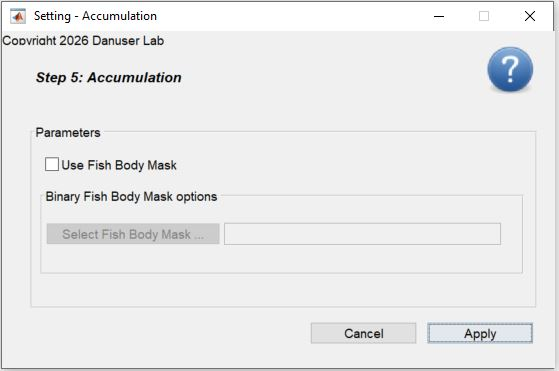

# Accumulation Process Description

This process combines the registered cancer colony points from all fish within each dataset into a single point pattern. It retains each point's fish ID and area weight, and removes points outside a fish body mask. The accumulated point patterns are used for Statistical Analysis across experimental conditions.

## Parameter Descriptions:

### Use Fish Body Mask:

If this box is checked, the selected binary fish body mask defines which points are inside the fish. If unchecked, a mask is generated automatically from the reference image. Check the generated mask to ensure it follows the fish body.

### Select Fish Body Mask ...:

This allows you to select a binary TIFF fish body mask when Use Fish Body Mask is checked. The mask should match the reference image's size and orientation, with the fish body marked by nonzero pixels and the background by zeros. The selected file's full path appears in the adjacent box.

## GUI Example

**Note:** The parameter values shown in this guide are examples. For each step, adjust the parameters to suit your experimental conditions and image acquisition settings.
