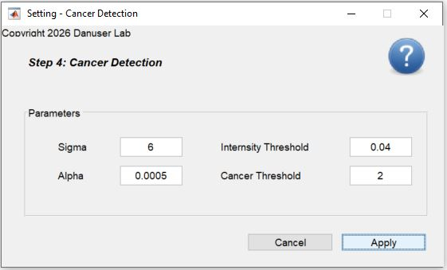

# Cancer Detection Process Description

This process detects cancer colonies in the preprocessed cancer channel and represents them as points. It removes dim detections, creates a binary cancer image to estimate colony area, and maps the detected points into the reference image using the transformations from Registration. The registered points and their area weights are used in Accumulation.

## Parameter Descriptions:

### Sigma:

This sets the spatial scale, in pixels, used for point-source detection of cancer colonies. Use larger values for larger colonies. The default is 6.

### Intensity Threshold:

This sets the minimum detected amplitude as a fraction of the larger of the brightest pixel intensity and the largest detected amplitude in each fish image. For example, 0.04 removes detections below 4% of that value. The default is 0.04.

### Alpha:

This sets the significance level used for point-source detection. Lower values apply a stricter detection criterion and help reject noise. The default is 0.0005.

### Cancer Threshold:

This sets the number of intensity thresholds calculated to segment the cancer channel. The lowest calculated threshold is used to create the binary image for estimating colony area weights. Enter a positive integer. The default is 2.

## GUI Example

**Note:** The parameter values shown in this guide are examples. For each step, adjust the parameters to suit your experimental conditions and image acquisition settings.
