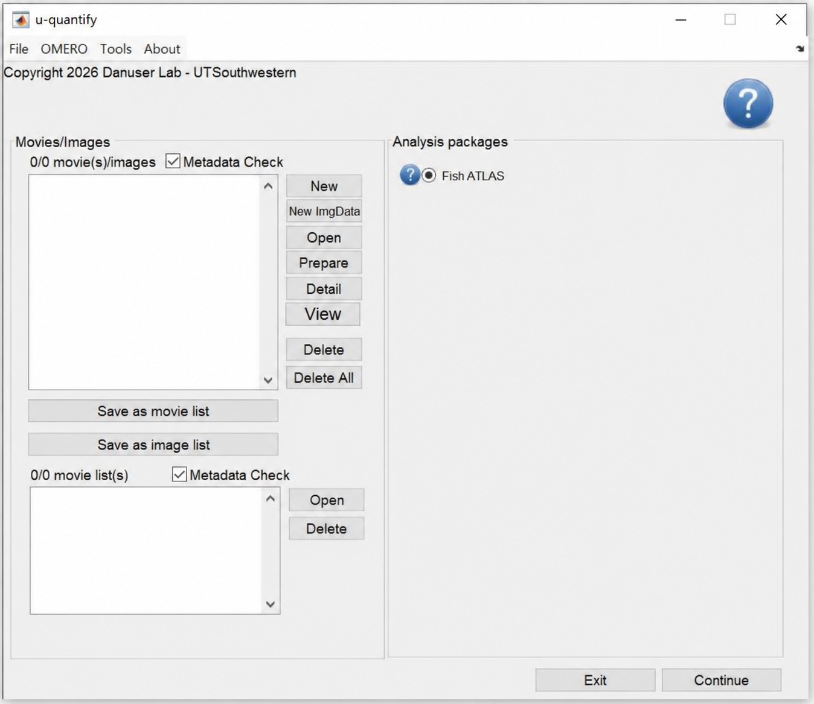
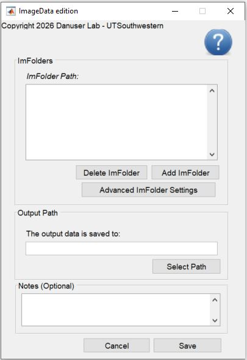
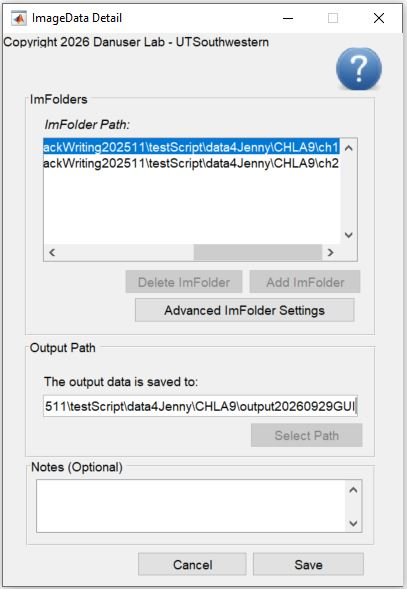
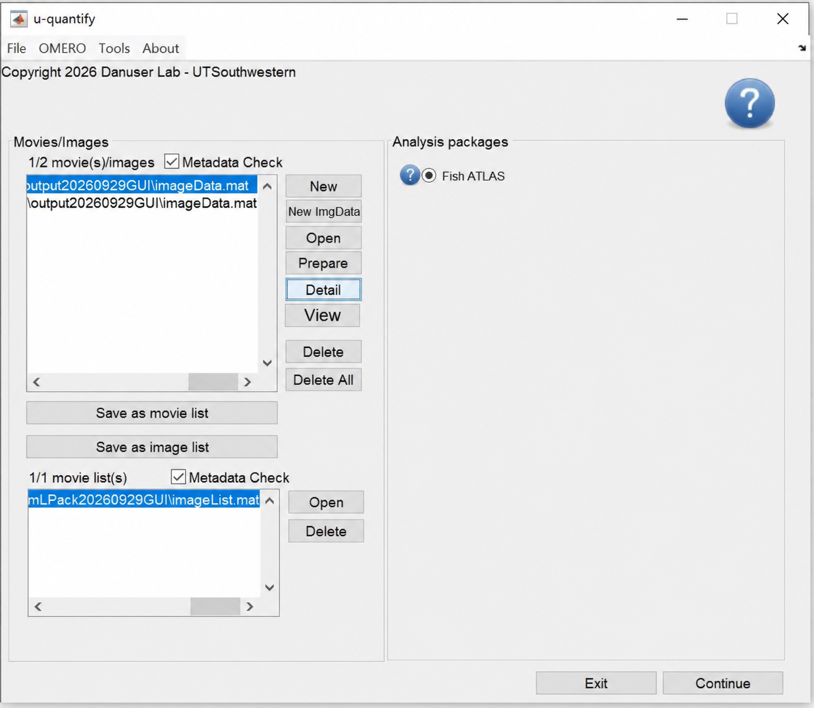

# Getting Started

FishATLAS uses an ImageList containing multiple ImageData datasets. Each ImageData groups the image folders (ImFolders) for one dataset or experimental condition, with one folder per channel.

## Launch FishATLAS

After completing [Installation](Installation), type the following command in the MATLAB Command Window:

```matlab
u_quantify()
```



Click **New ImgData** to open the **ImageData edition** window.

## Create ImageData by Adding ImFolders

Organize each dataset into at least two channel folders, such as `ch1` for the registration channel and `ch2` for the cancer channel. Use the same number and order of channels across datasets. Each folder should contain one TIFF image per fish. Channel folders within a dataset must contain the same filenames in the same order, with matching image dimensions for each fish. Different fish may have different image sizes. Each filename must contain exactly one numeric fish ID, such as `fish_0001.tif`.



1. In the **ImFolders** panel, click **Add ImFolder** and select the folder for the first channel.
2. Repeat **Add ImFolder** for the remaining channels. Keep the channel order consistent across all datasets. Channel 1 is used for automatic cropping and orientation in Pre-processing.
3. Under **Output Path**, click **Select Path** and choose a folder for this dataset's analysis results.
4. If needed, use **Advanced ImFolder Settings** to enter image metadata, and add optional notes.
5. Click **Save** and choose a name and location for the ImageData `.mat` file, for example `imageData.mat` in the dataset's output folder.

The saved ImageData appears in the upper **Movies/Images** list in u-quantify. To review its folders and output path, select it and click **Detail**. The example below shows a saved dataset with two channel folders.



Repeat **New ImgData** to create an ImageData for each additional dataset or condition, using a separate output folder for each.

## Create an ImageList and Start Analysis

Once all datasets have been added, click **Save as image list**. This groups all ImageData entries currently loaded in the upper list into an ImageList. Choose a filename, such as `imageList.mat`, then select a folder for the ImageList-level analysis results.

The saved ImageList appears in the lower list.



Select **Fish ATLAS** under **Analysis packages**, then click **Continue** to open the package window. Begin with [Pre-processing](Pre-processing-Process-Description); see the [FishATLAS Package Description](FishATLAS-Package-Description) for the complete workflow.
