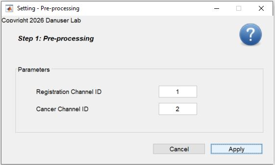

# Pre-processing Process Description

This process prepares fish images for registration by automatically cropping around the fish, padding the images to a common size within each dataset, and flipping them horizontally when needed to make their orientation consistent. The same operations are applied to all channels of each fish. The resulting images are used by Reference Image Creation and Registration. Cropping and flipping use channel 1 to identify the fish body.

## Parameter Descriptions:

### Registration Channel ID:

This specifies which channel is used by Reference Image Creation and Registration, typically the vasculature channel. Enter a positive whole-number channel ID corresponding to its image folder. The default is 1. Changing this setting does not change the channel used for cropping and flipping.

### Cancer Channel ID:

This specifies which channel contains the cancer signal used by Cancer Detection. Enter a positive whole-number channel ID corresponding to its image folder. The default is 2. It must be different from Registration Channel ID. Keep the channel order consistent across all datasets in the ImageList.

## GUI Example

**Note:** The parameter values shown in this guide are examples. For each step, adjust the parameters to suit your experimental conditions and image acquisition settings.
