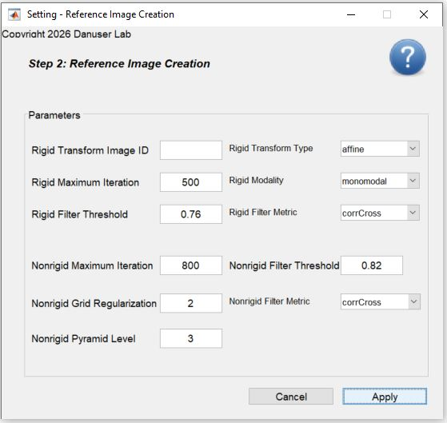

# Reference Image Creation Process Description

This optional process creates a shared reference image from the preprocessed fish images across datasets in the ImageList. It aligns images using the registration channel specified in Pre-processing, filters poorly registered images, and combines the groupwise registered images into a reference. The resulting reference image can be selected in the Registration process.

## Parameter Descriptions:

### Rigid Transform Image ID:

This specifies the initial reference image for rigid registration by its position in the pooled image list. Leave it blank to select an image randomly.

### Rigid Transform Type:

This selects the transformation used for initial alignment: `translation` allows shifts; `rigid` allows shifts and rotation; `similarity` also allows uniform scaling; and `affine` also allows nonuniform scaling and shearing. The default is `affine`.

### Rigid Maximum Iteration:

This sets the maximum number of optimization iterations for rigid registration. Larger values allow more time for alignment. The default is 500.

### Rigid Modality:

This selects the registration configuration. Use `monomodal` for images with similar intensity patterns or `multimodal` for images with different intensity relationships. The default is `monomodal`.

### Rigid Filter Threshold:

This sets the minimum similarity score required to retain an image after rigid registration. Higher values apply stricter filtering. The default is 0.7; adjust it for the selected Rigid Filter Metric.

### Rigid Filter Metric:

This selects how registered images are compared with the reference: `MutualInfo`, `ssim`, `pHash`, `corrCross`, `MSE`, or `featureExtract`. The default is `corrCross`, which uses normalized cross-correlation. Threshold values depend on the selected metric.

### Nonrigid Maximum Iteration:

This field is displayed in the GUI, with a default of 800, but has no effect on the groupwise nonrigid registration used in this process.

### Nonrigid Filter Threshold:

This sets the minimum similarity score required to retain an image after groupwise nonrigid registration. Higher values apply stricter filtering. The default is 0.7; adjust it for the selected Nonrigid Filter Metric.

### Nonrigid Grid Regularization:

This controls the penalty on grid displacement during groupwise nonrigid registration. Larger values constrain deformation more strongly. The default is 2.

### Nonrigid Filter Metric:

This selects the metric used to compare nonrigidly registered images with the combined reference. The options are `MutualInfo`, `ssim`, `pHash`, `corrCross`, `MSE`, and `featureExtract`. The default is `corrCross`.

### Nonrigid Pyramid Level:

This sets the number of image resolution levels used for groupwise nonrigid registration. Enter a positive integer. The default is 3.

## GUI Example

**Note:** The parameter values shown in this guide are examples. For each step, adjust the parameters to suit your experimental conditions and image acquisition settings.
