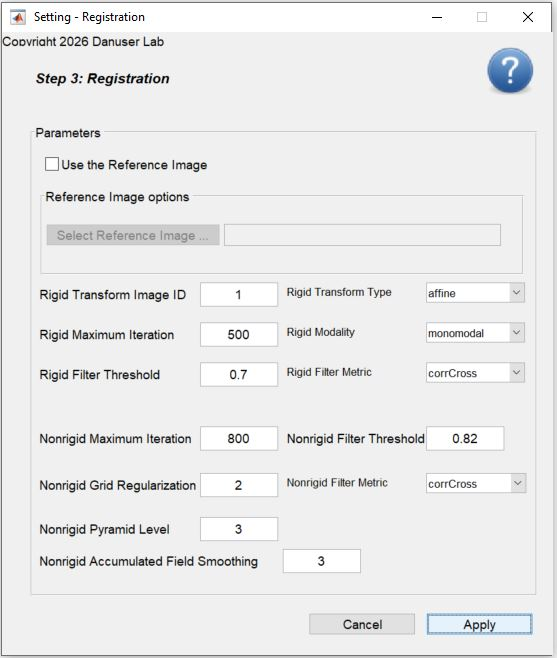

# Registration Process Description

This process aligns preprocessed fish images using the registration channel specified in Pre-processing. It performs an initial geometric alignment followed by nonrigid registration to account for differences in fish shape. Images can be aligned to an existing reference or registered as a group to generate a reference for each dataset. The same transformations are applied to the cancer channel and are saved for mapping detected cancer colonies.

## Parameter Descriptions:

### Use the Reference Image:

If this box is checked, each fish is aligned to the selected reference image. If unchecked, the process performs groupwise registration within each dataset and generates a reference image.

### Select Reference Image ...:

This allows you to select a TIFF reference image when Use the Reference Image is checked. You can use the image produced by Reference Image Creation or another suitable reference. The selected file's full path appears in the adjacent box.

### Rigid Transform Image ID:

This specifies the initial reference image by its position within each dataset when Use the Reference Image is unchecked. The default is 1. Leave it blank to select an image randomly. This setting is ignored when an external reference is selected.

### Rigid Transform Type:

This selects the transformation used for initial alignment: `translation` allows shifts; `rigid` allows shifts and rotation; `similarity` also allows uniform scaling; and `affine` also allows nonuniform scaling and shearing. The default is `affine`.

### Rigid Maximum Iteration:

This sets the maximum number of optimization iterations for rigid registration. Larger values allow more time for alignment. The default is 500.

### Rigid Modality:

This selects the registration configuration. Use `monomodal` for images with similar intensity patterns or `multimodal` for images with different intensity relationships. The default is `monomodal`.

### Rigid Filter Threshold:

This sets the minimum similarity score used to assess rigid registration. Images below this threshold are flagged; in groupwise registration, they are excluded from the subsequent nonrigid stage. The default is 0.7.

### Rigid Filter Metric:

This selects how rigidly registered images are compared with the reference: `MutualInfo`, `ssim`, `pHash`, `corrCross`, `MSE`, or `featureExtract`. The default is `corrCross`, which uses normalized cross-correlation. Adjust Rigid Filter Threshold for the selected metric.

### Nonrigid Maximum Iteration:

This sets the number of demons registration iterations at each image resolution level when an existing reference is used. The default is 800. This value does not control groupwise registration.

### Nonrigid Filter Threshold:

This sets the similarity cutoff used to assess nonrigid registration. In groupwise registration, images below the cutoff are excluded when refining the reference. When an existing reference is used, low scores produce warnings. The default is 0.7; adjust it for the selected Nonrigid Filter Metric.

### Nonrigid Grid Regularization:

This controls the penalty on grid displacement for deformable and groupwise registration. Larger values constrain deformation more strongly. The default is 2.

### Nonrigid Filter Metric:

This selects the metric used to assess nonrigid registration. With an existing reference, it also selects between the demons and deformable registration results. Options are `MutualInfo`, `ssim`, `pHash`, `corrCross`, `MSE`, and `featureExtract`. The default is `corrCross`.

### Nonrigid Pyramid Level:

This sets the number of image resolution levels used for nonrigid registration. Enter a positive integer. The default is 3.

### Nonrigid Accumulated Field Smoothing:

This sets the standard deviation, in pixels, of Gaussian smoothing applied to the accumulated displacement field at each demons registration iteration. Larger values produce smoother deformations. The default is 3. This setting applies when an existing reference is used.

## GUI Example

**Note:** The parameter values shown in this guide are examples. For each step, adjust the parameters to suit your experimental conditions and image acquisition settings.
