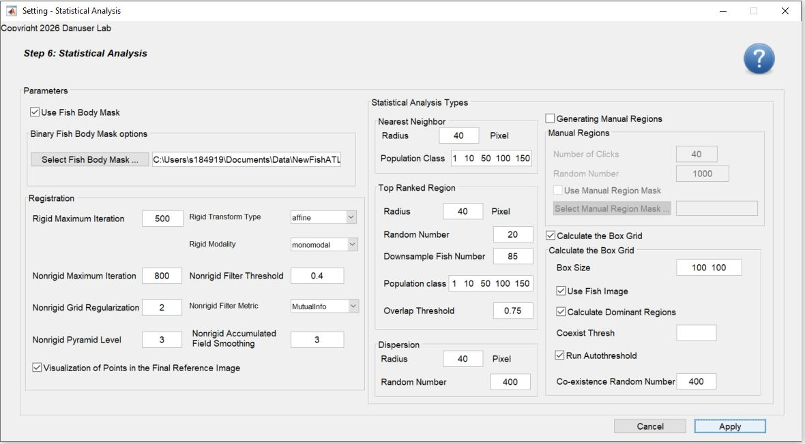

# Statistical Analysis Process Description

This process compares accumulated cancer colony point patterns across experimental conditions. It aligns each dataset's reference image and points to a common reference, then measures local point density, reproducible enriched regions, and dispersion relative to random distributions. Optional analyses test enrichment in a manually defined region and compare point populations and coexistence between grid regions.

## Parameter Descriptions:

The GUI's Parameters area contains fish body mask controls and the Registration panel on the left, and the Statistical Analysis Types panel on the right. The sections below follow this layout.

### Fish Body Mask Controls

These controls are at the upper left, above the Registration panel.

#### Use Fish Body Mask:

If this box is checked, the selected binary mask defines the fish body for edge correction and random point generation. If unchecked, you will be prompted to outline the fish body on the final reference image.

#### Binary Fish Body Mask options panel

This panel is enabled by the Use Fish Body Mask checkbox above it.

##### Select Fish Body Mask ...:

This allows you to select a binary TIFF fish body mask. Match its size and orientation to the final reference image, with nonzero pixels inside the fish and zeros outside. The selected file's full path appears in the adjacent box.

### Registration panel

These settings align the reference images across conditions before comparing their point patterns.

#### Rigid Maximum Iteration:

This sets the maximum number of optimization iterations for initial alignment of the reference images. The default is 500.

#### Rigid Transform Type:

This selects the initial transformation: `translation` allows shifts; `rigid` adds rotation; `similarity` adds uniform scaling; and `affine` also allows nonuniform scaling and shearing. The default is `affine`.

#### Rigid Modality:

This selects `monomodal` for images with similar intensity patterns or `multimodal` for images with different intensity relationships. The default is `monomodal`.

#### Nonrigid Maximum Iteration:

This sets the number of demons registration iterations at each image resolution level when aligning reference images. The default is 800.

#### Nonrigid Filter Threshold:

This sets the minimum similarity score expected after nonrigid registration. A warning is issued if neither registration method reaches it. The default is 0.7; adjust it for the selected Nonrigid Filter Metric.

#### Nonrigid Grid Regularization:

This controls the penalty on grid displacement in deformable registration. Larger values constrain deformation more strongly. The default is 2.

#### Nonrigid Filter Metric:

This selects the metric used to compare the demons and deformable registration results and choose the closer match to the reference. Options are `MutualInfo`, `ssim`, `pHash`, `corrCross`, `MSE`, and `featureExtract`. The default is `corrCross`.

#### Nonrigid Pyramid Level:

This sets the number of image resolution levels used for nonrigid registration. Enter a positive integer. The default is 3.

#### Nonrigid Accumulated Field Smoothing:

This sets the standard deviation, in pixels, of Gaussian smoothing applied to the accumulated displacement field at each demons registration iteration. Larger values produce smoother deformations. The default is 3.

#### Visualization of Points in the Final Reference Image:

If this box is checked, the process saves overlays of each condition's registered points on the final reference image.

### Statistical Analysis Types panel

This panel is on the right side of the GUI. It contains the Nearest Neighbor, Top Ranked Region, Dispersion, Manual Regions, and Calculate the Box Grid subpanels described below. Radii and grid dimensions are measured in pixels of the final reference image.

#### Nearest Neighbor subpanel

##### Radius:

This sets the neighborhood radius, in pixels, used to count neighboring points around each colony. Counts are corrected for neighborhoods that extend beyond the fish body. The default is 40.

##### Population Class:

This specifies ascending upper limits for grouping points by their corrected neighbor counts. The default is `1 10 50 100 150`, corresponding to counts up to 1, above 1 through 10, and so on.

#### Top Ranked Region subpanel

##### Radius:

This sets the neighborhood radius, in pixels, for identifying density regions in repeated fish subsamples. The default is 40.

##### Random Number:

This sets the number of random fish subsamples used to identify reproducible regions. The default is 20.

##### Downsample Fish Number:

This sets the number of fish selected per condition in each subsample. For matched sample sizes, choose a value no larger than the smallest number of fish with retained points in any condition. If fewer fish are available, all available fish are used. The default is 85.

##### Population class:

This specifies ascending upper neighbor-count limits for the density classes used to build region masks. The default is `1 10 50 100 150`.

##### Overlap Threshold:

This sets the minimum fraction of subsampling runs in which a pixel must belong to a density region to be retained. The default is 0.75, meaning at least 75% of runs.

#### Dispersion subpanel

##### Radius:

This sets the neighborhood radius, in pixels, for comparing the observed point pattern with random patterns to assess clustering or isolation. The default is 40. Keep it equal to Radius in the Nearest Neighbor subpanel: the current edge correction for observed points uses that value.

##### Random Number:

This sets the number of random point patterns generated within the fish body for the dispersion comparison. The default is 400.

#### Generating Manual Regions (checkbox)

If this box is checked, the process tests whether a selected region contains more points than expected from random placement within the fish body.

#### Manual Regions subpanel

This subpanel is inside Statistical Analysis Types and is enabled by the Generating Manual Regions checkbox above it.

##### Number of Clicks:

This sets the number of points you click to outline the region when creating a new mask. The default is 40.

##### Random Number:

This sets the number of random point patterns used to estimate the region's enrichment p-value. The default is 1000.

##### Use Manual Region Mask:

If this box is checked, the process loads the selected region mask. If unchecked, you will be prompted to outline a region on the final reference image.

##### Select Manual Region Mask ...:

This allows you to select a binary TIFF region mask matching the final reference image's size and orientation. Nonzero pixels define the region of interest. The selected file's full path appears in the adjacent box.

#### Calculate the Box Grid (checkbox)

If this box is checked, the process divides the reference image into rectangular regions, counts points per fish in each region, and calculates regional coexistence.

#### Calculate the Box Grid subpanel

This subpanel is inside Statistical Analysis Types and is enabled by the Calculate the Box Grid checkbox above it.

##### Box Size:

This sets the two grid box dimensions, in pixels. Enter two positive values. The default is `100 100`.

##### Use Fish Image:

If this box is checked, the grid is positioned around the fish body identified in the reference image. If unchecked, the grid covers the full image.

##### Calculate Dominant Regions:

If this box is checked, pairwise rank-sum tests compare point counts per fish between conditions in each grid region to identify regional differences.

##### Coexist Thresh:

This field accepts coexistence cutoffs between 0 and 1, one per condition, for chord diagrams. It is blank by default. The current implementation recalculates these cutoffs from random patterns whenever values are entered or Run Autothreshold is checked.

##### Run Autothreshold:

If this box is checked, random point patterns are used to estimate a coexistence cutoff for each condition and grid size. Leave Coexist Thresh blank when using this option.

##### Co-existence Random Number:

This sets the number of random point patterns used to estimate the coexistence cutoffs. The default is 400.

## GUI Example

**Note:** The parameter values shown in this guide are examples. For each step, adjust the parameters to suit your experimental conditions and image acquisition settings.
